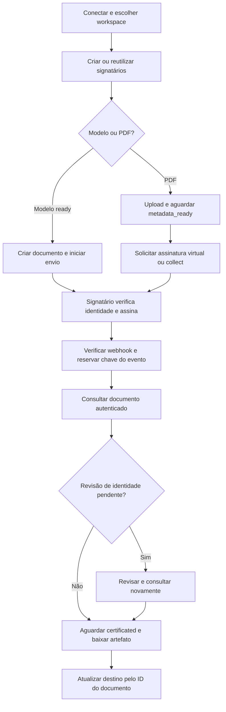

# Assinafy + Pluga

Kit de integração do ciclo de documentos da Assinafy com **Pluga Webhooks + HTTP Request**. Inclui receitas JSON, cliente TypeScript sem dependências de execução, API key, OAuth2 com PKCE, contratos CLM, endpoints múltiplos e verificação de webhooks assinados.

As receitas orientam a configuração manual na Pluga; o código TypeScript executa no seu servidor. Um conector nativo e a publicação no catálogo dependem da aprovação da Pluga.

## Instalação e ambientes

Use Node.js 26 LTS atualizado. Também são suportados Node.js 22.23.4+, 24.22.1+ e 26.12.1+; a CI testa as três linhas. TypeScript 7 é dependência de desenvolvimento.

```sh
npm ci
npm run check
npm run contract
```

| Ambiente | API | Aplicação |
|---|---|---|
| Sandbox | `https://sandbox.assinafy.com.br/v1` | `https://app-sandbox.assinafy.com.br` |
| Produção | `https://api.assinafy.com.br/v1` | `https://app.assinafy.com.br` |

Credenciais e registros não atravessam ambientes. Os scripts exigem `ASSINAFY_ENVIRONMENT`; o construtor mantém produção como padrão para clientes existentes.

```js
import { AssinafyClient, runAction } from './dist/index.js';

const client = new AssinafyClient({
  type: 'api_key',
  apiKey: process.env.ASSINAFY_API_KEY,
  accountId: process.env.ASSINAFY_ACCOUNT_ID,
  environment: 'sandbox',
});
await client.workspace();
```

Cada cliente confirma o workspace em `GET /accounts`. Para contas de clientes, prefira OAuth2; o ID selecionado não reduz os privilégios de uma API key.

## Fluxo completo



### 1. Crie ou reutilize signatários

Consulte `GET /accounts/ACCOUNT_ID/signers` antes de criar. `POST /accounts/ACCOUNT_ID/signers` aceita `full_name` e, opcionalmente, `email`, `whatsapp_phone_number` E.164 e `government_id` CPF/CNPJ. Criar o contato não envia convite.

```js
const signer = await runAction('create_signer', client, {
  body: { full_name: 'Signatário de exemplo', email: 'signer@example.com' },
});
```

### 2. Prepare e envie o documento

Para um modelo `ready`, mapeie cada papel Signer exatamente uma vez, CopyReceiver quando necessário e todos os campos Editor. A criação retorna `uploaded` com `assignment: null` e termina de processar em segundo plano.

```js
const sent = await runAction('create_document_from_template', client, {
  template_id: templateId,
  body: { signers: [{ id: signer.id, role_id: roleId, verification_method: 'Email' }] },
});
```

Para PDF, use multipart sem definir `Content-Type`; o transporte cria o boundary. Aguarde `uploaded → metadata_processing → metadata_ready`. `virtual` aceita o processamento em andamento; `collect` exige páginas prontas e campos em pixels do raster a 150 DPI.

```js
const form = new FormData();
form.set('file', new Blob([pdfBytes], { type: 'application/pdf' }), 'contrato.pdf');
const uploaded = await client.upload(await client.accountPath('/documents'), form);
```

Depois, chame `request_signatures` com `method: "virtual"` ou `"collect"`. O cliente recusa assignment existente, contatos de outro workspace, passos inválidos e placements fora da página.

### 3. Escolha verificação e notificação

| Verificação | Notificação | Requisitos |
|---|---|---|
| `Email` | `Email` | E-mail válido |
| `Whatsapp` | `Whatsapp` | E.164, recurso do plano e créditos |
| `DigitalCertificate` | `Email` ou `Whatsapp` | `virtual`, CPF/CNPJ, ICP-Brasil A1/A3 e um signatário por passo |
| `IdDocumentFaceMatchBasic` | `Email` ou `Whatsapp` | CPF e recurso ID Document + Face Match |

Use exatamente um canal em `notification_methods`. Certificado digital não funciona com `collect` nem com modelo que tenha campos Signer posicionados. Na biometria, a captura consentida ocorre na interface da Assinafy; não envie imagens no payload. `InReview` pode levar o documento a `pending_identity_review` até aprovação ou rejeição.

### 4. Receba e autentique eventos

Crie uma URL privada na Pluga e registre um endpoint próprio em `POST /accounts/ACCOUNT_ID/webhooks/endpoints`. Se `signing_enabled` for `true`, guarde imediatamente o `secret` retornado; listas não o mostram.

```js
import { verifyWebhookSignature, normalizeEvent } from './dist/index.js';

const rawBody = await request.text();
await verifyWebhookSignature(rawBody, request.headers, webhookSecret);
const event = normalizeEvent(JSON.parse(rawBody), accountId, request.headers.get('webhook-id'));
```

Verifique o corpo original e os headers `webhook-id`, `webhook-timestamp` e `webhook-signature`. Reserve `event.deduplication_key` atomicamente antes de efeitos repetíveis; o helper não mantém armazenamento. Se a Pluga não expuser corpo e headers originais, verifique em um receptor próprio antes de encaminhar.

Eventos podem repetir e chegar fora de ordem. `document_ready` ocorre após certificação e revisões exigidas; `signer_signed_document` representa uma assinatura individual. Sempre confirme `object.id` por GET autenticado.

### 5. Confirme e baixe

```js
const current = await runAction('get_document', client, { document_id: event.document_id });
if (current.status === 'certificated') {
  const pdf = await client.binary(`/documents/${current.id}/download/certificated`);
}
```

O fim normal é `pending_signature → certificating → certificated`. Escolha somente artefatos presentes em `document.artifacts`: `original`, `certificated`, `certificate-page`, `bundle`, `thumbnail` e, para certificado digital, `pades`. Downloads aceitam até 50 MiB por padrão; redirects externos precisam de origem HTTPS configurada em `trustedDownloadOrigins` e não recebem credenciais.

### 6. Associe termos CLM

`updateContract` registra vigência, valor, renovação e referências do CRM sem solicitar assinatura. Use `updated_at` como precondição, reconcilie HTTP 409 e liste por `-updated_at` para recuperar eventos perdidos. Aditivos são outros documentos ligados por `parent_document_id`; só alteram o pai quando certificados. Veja [payloads e respostas CLM](docs/CONTRACTS.md).

### 7. Conecte contas com OAuth2

Registre uma aplicação public ou confidential com callback HTTPS exato. O helper usa authorization code, PKCE S256, `state`, `iss` e hosts separados por ambiente.

```js
import { createOAuthAuthorization, exchangeOAuthCode } from './dist/index.js';

const session = await createOAuthAuthorization({
  clientId,
  clientSecret,
  environment: 'production',
  redirectUri: 'https://app.example.com/oauth/callback',
  scopes: ['account:read', 'documents:read', 'documents:write', 'templates:read'],
});
const tokens = await exchangeOAuthCode(session, callbackUrl, clientSecret);
```

Guarde sessão e tokens por conexão. Para refresh token, solicite `offline_access`; serialize refresh, persista o token rotacionado antes de usá-lo e nunca reutilize um code ou refresh token após resultado incerto. Revogue tokens ao desconectar.

## Falhas e recuperação

| Situação | Tratamento |
|---|---|
| 400 / 422 | Corrigir campos, papéis, canais ou geometria |
| 401 | Reconectar ou renovar OAuth de forma serializada |
| 403 | Conferir workspace, escopos e recurso do plano |
| 429 | Respeitar `Retry-After` |
| Timeout / 5xx após escrita | Consultar o efeito antes de repetir |
| Evento repetido | Reservar a chave e consultar o estado atual |

Não há retry automático de mutações. `IntegrationError` expõe `code`, `httpStatus`, `safeToRetry`, `outcomeUnknown` e `retryAfterSeconds` sem incluir corpos privados do serviço.

## Referência

- [Funções, tipos e payloads completos](docs/API.md)
- [Contratos e aditivos](docs/CONTRACTS.md)
- [Configuração manual na Pluga](docs/SETUP.md)
- [Testes e release](docs/TESTING.md)
- [Guia público](public-guide/README.md)
- [Receitas JSON](recipes/requests.json)
- [OpenAPI oficial](https://api.assinafy.com.br/v1/docs/openapi.json)

`npm run smoke` faz somente leituras com credenciais de ambiente. `AGENTS.md`, `CLAUDE.md`, `.env`, `.secrets/` e `artifacts/` são locais/ignorados. Exemplos publicados usam domínios reservados; nunca registre credenciais, callbacks privados ou destinatários reais.
